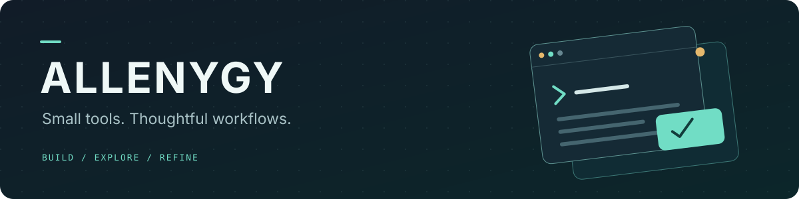

  

  Building useful tools for everyday workflows. 
  Exploring native apps, language tools, and practical automation.

  <a href="#selected-projects">Selected projects</a> ·
  <a href="#areas-of-interest">Areas of interest</a> ·
  <a href="https://github.com/AllenYGY?tab=repositories">All repositories</a>

### Selected projects

<table>
  <tr>
    <td valign="top" width="50%">
      <h3><a href="https://github.com/AllenYGY/overshelf">OverShelf ↗</a></h3>
      
A native macOS top-edge drawer for the things you need within reach.

      macOS · Everyday productivity
    </td>
    <td valign="top" width="50%">
      <h3><a href="https://github.com/AllenYGY/LiveTranslateBobPlugin">Live Translate ↗</a></h3>
      
A Bob plugin for real-time Chinese–English subtitle translation.

      Swift · Translation · Subtitles
    </td>
  </tr>
  <tr>
    <td valign="top" width="50%">
      <h3><a href="https://github.com/AllenYGY/MailTranslator">MailTranslator ↗</a></h3>
      
Bilingual reading in Apple Mail. Product information and support.

      Apple Mail · Bilingual reading
    </td>
    <td valign="top" width="50%">
      <h3><a href="https://github.com/AllenYGY?tab=repositories">More to explore ↗</a></h3>
      
Browse more tools, experiments, and projects across my public repositories.

      Tools · Experiments · Code
    </td>
  </tr>
</table>

### Areas of interest

- **Native experiences** — small, focused tools that fit into everyday workflows.
- **Language tools** — translation, subtitles, and bilingual reading.
- **Practical automation** — making repetitive work simpler.

---

Small tools. Thoughtful workflows.

